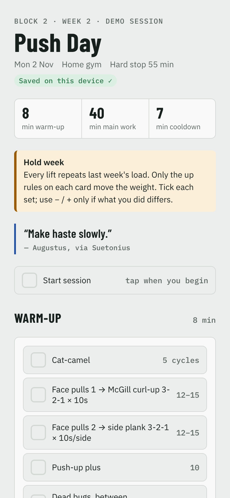

# Training Sheet

A phone-first gym sheet I built for my own strength training and use every session. Tick sets as you go, nudge load and reps with steppers, log effort (RPE), and a rest timer starts itself.

**[Live demo](https://cdoor4.github.io/workout-tracker/)** · single HTML file · no build step · no account

## The problem

Training apps are built for logging *after* the fact, or for following a fixed plan. Neither works when the plan changes every session based on how the last one went, and when your hands are full of a barbell. I needed three things from one screen:

1. **What to do right now**, with the progression rule on the card ("all sets ≤ RPE 7 → +2.5kg next time"), so the decision is made in the moment, not afterwards.
2. **One-tap logging** that defaults to the prescription, so you only touch the screen when reality differs.
3. **Structured output** a coach (human or AI) can read back to plan the next session.

## How it works

- **Content is data.** Each session is a JSON block in the page ([schema](docs/session-schema.md)). The CSS/JS never change per session. An AI coach writes the JSON from my training history; I train; the coach reads the stored results back and decides the next session's loads.
- **Prefilled sets.** Every set starts at the target load and reps. A tick means "done as written"; − / + only when it wasn't.
- **Auto rest timer.** Ticking a set starts the right rest for that lift (2 min heavy compounds, 60s isolation), with ±15s, vibration at zero, and a count-up after.
- **Rules on the card.** Up/down progression rules sit under each lift, so autoregulation happens mid-session.
- **Ramp sets and supersets** are tickable too, so warm-ups actually get done.
- **Saves every tap.** localStorage by default; an optional sync adapter writes to a document store when one is available.
- **Time budget.** Warm-up / main / cooldown minutes up top; the last exercise is labelled "cut first if over time".

## Product decisions and trade-offs

| Decision | Why | Trade-off accepted |
|---|---|---|
| Single self-contained HTML file | Works offline in a garage gym, zero hosting cost, trivially portable | No multi-device sync without the adapter |
| Config-driven sessions | Lets an LLM generate sessions without touching code; nothing to break | Schema has to be documented and stable |
| Defaults = prescription | Most sets need one tap; logging survives fatigue | Easy to tick without reading; RPE nudges you to check in |
| Motivational lines in the rest timer | Rest is dead time on a phone; a short reason to keep going beats doom-scrolling | Has to stay short and sourced, or it's noise |

## What I'd measure if this were a product

- **Session completion rate** (finish ticked ÷ sessions opened): the north star.
- **Logging accuracy:** share of sets edited away from the default (too low suggests blind ticking).
- **Progression adherence:** when an up rule fires, is the load actually raised next time?
- **Rest timer adherence** against prescription.

## Built with

Vanilla HTML/CSS/JS, no dependencies. Designed and built with Claude Code as my pair programmer.

## Run it

Open `index.html` in a browser, or serve the folder with GitHub Pages.
